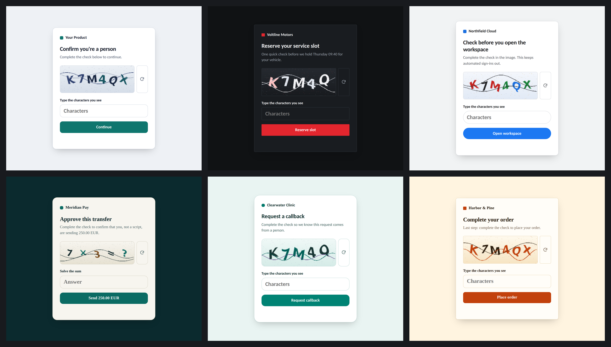
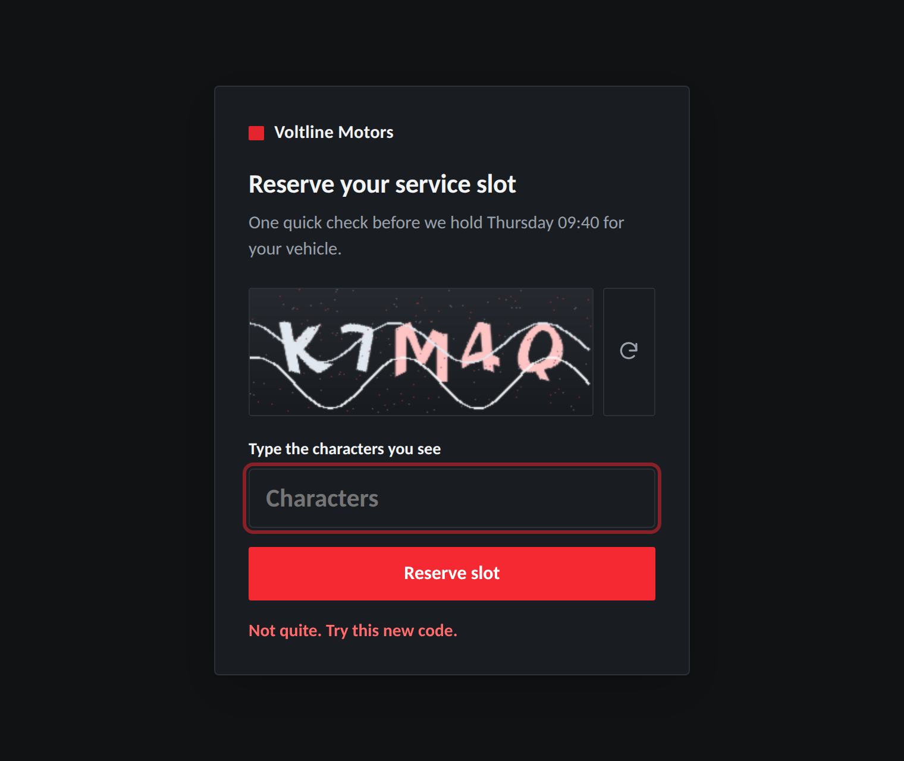
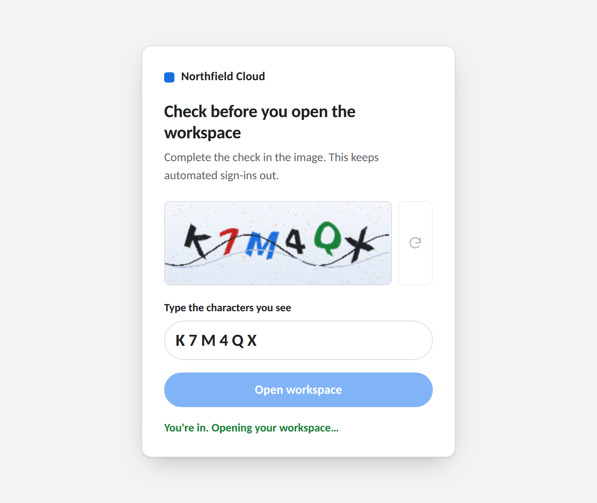
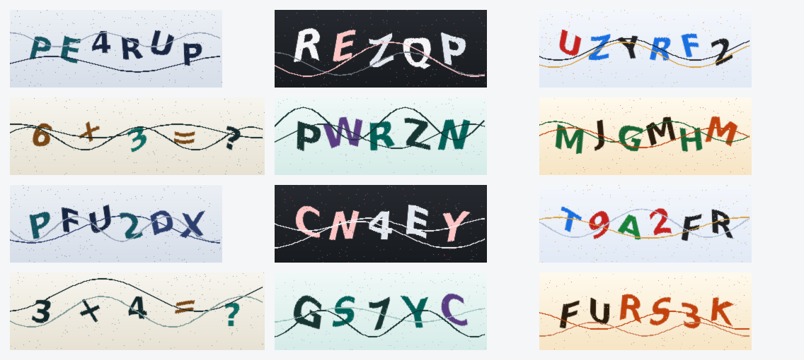

# HumanCheck

A general-purpose **human-verification toolkit** in Python. It draws a distorted challenge (characters or a short sum), issues a signed, expiring, single-use token, and checks the answer



## Why it is different from a basic captcha script

| | Basic script | HumanCheck |
|---|---|---|
| Image drawing | third-party `captcha` package | built-in Pillow renderer (per-glyph rotation, wave warp, crossing strokes, speckle) |
| Answer handling | kept in a global variable | never leaves the server; token holds only a keyed digest |
| Safety | none | HMAC-signed, expires, limited attempts, single use |
| Use case | one fixed window | **profiles**: copy, colours and rules per product or action |
| Challenge types | characters | characters and sums |
| Interface | desktop window | web UI (responsive, keyboard and screen-reader friendly), CLI, Python API |

## Install

```bash
pip install -r requirements.txt     # Pillow + numpy
python -m unittest discover -s tests
```

Python 3.9+. No other runtime dependencies; the demo server uses only the standard library

## Quick start

```bash
python -m humancheck serve --profile ev-motors      # http://127.0.0.1:8000/?profile=ev-motors
python -m humancheck serve --brand "My Company"     # relabel every profile
python -m humancheck generate --out c.png           # writes c.png, prints the answer
python -m humancheck gallery --out samples.png      # contact sheet of sample challenges
```

Add `&embed=1` to the page URL to hide the demo switcher, or `&kind=math` for sum challenges

## Profiles (the "action")

Each profile bundles the wording, the look, and the challenge rules for one situation

| Key | Scenario | Challenge |
|---|---|---|
| `generic` | Neutral "confirm you're a person" gate | characters |
| `ev-motors` | Reserve a vehicle service slot | characters (dark theme) |
| `search-cloud` | Check before opening a cloud workspace | characters |
| `fintech` | Approve a payment | sum |
| `healthcare` | Request a callback | characters |
| `retail` | Complete an order | characters |

Brand names are neutral placeholders. Put your own name on them with `--brand`, or define a profile:

```python
from humancheck import Profile, Theme, Palette, PROFILES

PROFILES["my-app"] = Profile(
    key="my-app", brand="Your Brand", title="Confirm it's you",
    subtitle="Complete the check to continue.", button="Continue",
    success="Verified.", failure="Not a match. Try this one.",
    theme=Theme(accent="#7c3aed"), palette=Palette(inks=((124, 58, 237),)),
)
```

## Use it as a library

```python
from humancheck import ChallengeService, get_profile

service = ChallengeService()                       # one instance per process
profile = get_profile("generic")

challenge = service.create(profile)                # .png (bytes), .token, .prompt, .expires_in
# send challenge.png and challenge.token to the client ...

result = service.verify(token_from_client, answer_from_client)
if result.ok:
    ...                                            # result.reason is one of:
                                                   # ok | wrong | expired | invalid | used | exhausted
```

Set `HUMANCHECK_SECRET` (any long random string) so tokens survive restarts and work across workers
Attempt counters and replay protection are in-memory; with several workers, keep them in a shared store

## HTTP API (demo server)

| Method | Path | Purpose |
|---|---|---|
| GET | `/api/profiles` | list profiles |
| GET | `/api/profile/<key>` | copy and theme for one profile |
| GET | `/api/challenge?profile=<key>&kind=text\|math` | new challenge (`token`, `image` as a PNG data URI) |
| POST | `/api/verify` | `{"token","answer","profile"}` → `{"ok","reason","attempts_left"}`; failures include a fresh `challenge` |

## Project layout

```
humancheck/
  config.py       Profile / Theme / Palette dataclasses
  profiles.py     built-in profiles
  challenges.py   text and sum generation (uses `secrets`)
  renderer.py     Pillow image renderer
  verifier.py     signed, expiring, single-use tokens
  service.py      create() / verify() façade
  server.py       demo HTTP server
  cli.py          serve | generate | gallery
  static/         web UI (index.html, style.css, app.js)
tests/            unit and end-to-end tests
tools/            screenshot generator (needs Playwright)
docs/screenshots/ images used in this README
```

## Screenshots

Captured from the running app in headless Chromium by `tools/capture_screenshots.py`.

| Wrong answer (new challenge issued) | Verified |
|---|---|
|  |  |



